<p align="center">
  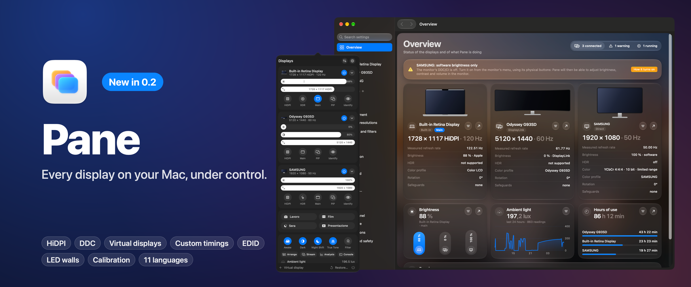
</p>

<h1 align="center">Pane</h1>

<p align="center">
  <b>Il centro di controllo degli schermi per macOS.</b><br>
  HiDPI a qualsiasi dimensione, controllo vero dei monitor, schermi virtuali, timing personalizzati, LED wall e calibrazione video —<br>
  in un'unica app nativa che vive nella barra dei menu.
</p>

<p align="center">
  
  
  
  
  
</p>

<p align="center">
  <a href="../../releases/latest"><b>⬇︎ Scarica</b></a> ·
  <a href="#novità-della-02">Novità</a> ·
  <a href="#funzioni">Funzioni</a> ·
  <a href="#perché-pane">Perché Pane</a> ·
  <a href="#screenshot">Screenshot</a> ·
  <a href="#installazione">Installazione</a> ·
  <a href="#automazione">Automazione</a> ·
  <a href="README.md">🇬🇧 English</a>
</p>

---

## In breve

Pane riunisce in un solo posto tutti gli schermi collegati al Mac: il pannello integrato, i monitor esterni, i TV, i dock, gli schermi virtuali e i LED wall. Rende nitido il testo su qualsiasi monitor con l'**HiDPI flessibile**, comanda **luminosità, contrasto, volume e ingresso** direttamente nel monitor via DDC/CI, crea **schermi virtuali**, costruisce **risoluzioni custom fino ai porch**, progetta **LED wall** e parla con le centraline **Novastar**, e **calibra** gli schermi sugli standard video.

È pensata per chi lavora davanti agli schermi tutto il giorno: professionisti del video e dell'audiovisivo, designer, sviluppatori e chiunque abbia più di un monitor. SwiftUI nativo e Liquid Glass, niente Electron: un download di 6 MB che a riposo usa lo 0 % di CPU.

<p align="center">
  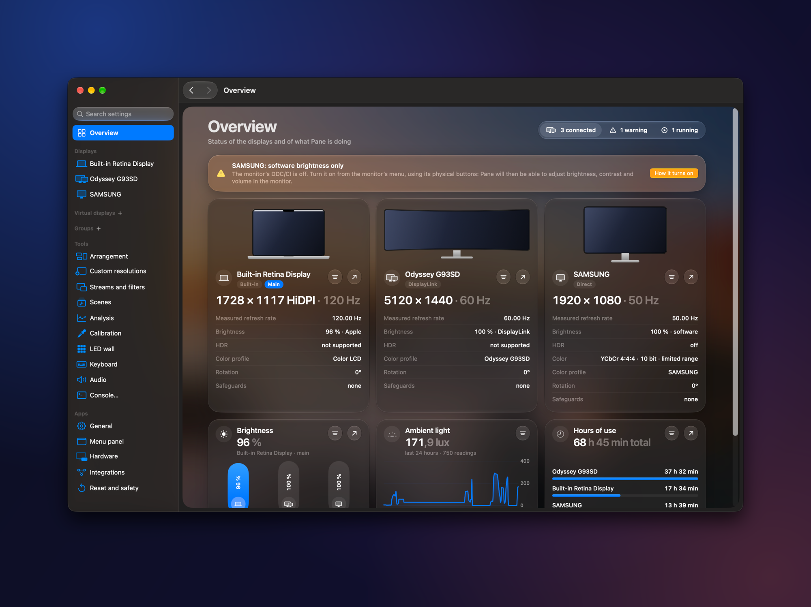
</p>

## Novità della 0.2

- **Mostrare invece di elencare.** La risoluzione si sceglie da cinque schermi disegnati. Il LED wall è disegnato in proporzione mentre scrivi, l'equalizzatore è una curva da trascinare, la calibrazione tre schede, le scorciatoie tasti veri.
- **Pagine più chiare.** Intestazione in vetro su ogni schermo con il riepilogo del collegamento, icone nelle sezioni, barre grandi per luminosità, contrasto e volume.
- **Aggiornamenti da GitHub.** Una volta al giorno Pane controlla e propone il download. Non invia nulla su di te o sul Mac.
- **Finestre al loro posto** quando un gruppo di schermi torna, con Annulla.
- **Cura OLED**: promemoria per la pulizia dei pixel e avviso se barra dei menu e Dock restano luminosi per ore.
- **Esporta diagnostica** in uno zip da allegare a una segnalazione, più correzioni a rete di sicurezza, luminosità DisplayLink e traduzioni. [Note complete](../../releases/tag/v0.2)

## Perché Pane

Pane fa quello che ti aspetti da un'utility per gli schermi — HiDPI flessibile, schermi virtuali, DDC/CI, Picture in Picture, strumenti EDID, luminosità XDR — e aggiunge strumenti che nelle altre app non trovi:

| | **Pane** | BetterDisplay | SwitchResX |
| --- | :---: | :---: | :---: |
| **Controllo delle centraline LED Novastar** (serie VX incluso VX Pro, serie H): luminosità, ingresso, preset, freeze, nero, pattern di test | ✅ | — | — |
| **Progettazione LED wall**: dai cabinet alla tela, passo, dimensioni, porte del processore, timing di uscita, uscita a fasce | ✅ | — | — |
| **Calcolo dei timing con la banda del cavo** per HDMI 1.4 / 2.0 / 2.1 e DisplayPort 1.2 / 1.4 / DSC / 2.1, *prima* di applicare | ✅ | — | — |
| **Controllo sui limiti dichiarati dall'EDID del monitor** con correzione in un clic (righe, pixel clock, TMDS) | ✅ | — | — |
| **Calibrazione video** su Rec.709, sRGB, Display P3 e DCI-P3, con procedura visiva e abbinamento del bianco tra monitor | ✅ | — | — |
| **Scene con attivazione automatica**: a un orario, sopra/sotto un livello di luce ambiente, quando si collega uno schermo | ✅ | — | — |
| **Cronologia annulla** degli ultimi 10 cambi (⌃⌥⌘Z) e backup prima di ogni ripristino | ✅ | — | — |
| **Prezzo** | Gratis | Gratis + Pro a pagamento | A pagamento |

<sub>In base all'elenco pubblico delle funzioni di ciascuna app (betterdisplay.pro, madrau.com) a novembre 2026; “—” significa che la funzione non vi compare. BetterDisplay e SwitchResX sono marchi dei rispettivi proprietari. Pane è un'app indipendente e non è affiliata con loro.</sub>

### Fatta per non lasciarti mai al buio

Cambiare le impostazioni degli schermi può lasciarti con uno schermo nero. Pane è progettata perché non resti mai così:

- **Ogni cambio rischioso chiede “Tenere?”** su tutti gli schermi e torna indietro da solo se non rispondi (risoluzione, frequenza, rotazione, EDID, modalità colore).
- **⌃⌥⌘Z annulla** l'ultimo comando, fino a 10 passi.
- **Il ripristino delle impostazioni di macOS** fa sempre un backup prima, e anche il ripristino si può annullare.
- **La protezione della configurazione** mantiene risoluzione, frequenza, rotazione, profilo colore, schermo principale e duplicazione come li hai scelti.
- I link e il server web locale possono usare solo i controlli degli schermi: comandi della shell, scrittura di file e impostazioni restano a te. Importando le impostazioni di qualcun altro, Pane chiede conferma prima di aggiungere comandi della shell.

## Funzioni

### Risoluzione e HiDPI
- **HiDPI flessibile su qualsiasi monitor**: testo nitido a qualsiasi dimensione, anche sui monitor a cui macOS offre solo la risoluzione nativa.
- Cursore della risoluzione, cinque risoluzioni preferite, frequenze, intervalli ProMotion/VRR, predefinita · nativa · metà in un clic.
- Area del notch sui MacBook, rotazione, schermo principale, duplicazione, preset di riferimento Apple sui display XDR.
- Frequenza misurata (non solo quella dichiarata) e test di regolarità dei fotogrammi.

### Luminosità e immagine
- Un solo cursore di luminosità per schermo: **prima l'hardware** (Apple, DDC/CI, dock DisplayLink), poi **l'attenuazione software fino al nero**.
- **Luminosità extra XDR / HDR** sui display che la supportano.
- Contrasto, gamma, temperatura colore, guadagno RGB, gamma per canale, quantizzazione: dal vivo, per ogni schermo.
- Profili colore con cinque preferiti, **ritocco del profilo** (contrasto, gamma, caldo/freddo, magenta/verde), **LUT 3D** (.cube) e filtri video.

### Controllo del monitor
- **DDC/CI**: luminosità, contrasto, volume, muto, ingresso (con i tuoi nomi), accensione, più qualsiasi codice VCP come controllo personalizzato, e tempi regolabili per i monitor difficili.
- **Dock DisplayLink**: luminosità e contrasto hardware, dove la maggior parte delle app ripiega sul software.
- **TV e ricevitori in rete** (LG, Samsung, Philips, Yamaha) e **HDMI-CEC** — *sperimentali*.
- Comandi della shell quando uno schermo si collega, si scollega, va in stop o si risveglia.

### Schermi virtuali
- Schermi virtuali fino a 16K, HiDPI, frequenze e diagonale a scelta: per Mac senza monitor, condivisione dello schermo e registrazioni.
- Associali a uno schermo fisico: si collegano da soli quando lo schermo è spento, vanno a tutto schermo su di lui, oppure lui li duplica sempre.

### Picture in Picture e trasmissioni
- **Picture in Picture** di qualsiasi schermo o delle finestre che scegli, con zoom, ritaglio, rotazione, trasparenza, clic passanti e filtri.
- **Trasmetti** uno schermo a tutto schermo su un altro, anche **a fasce** per i LED wall alimentati da un'uscita video normale.

### Risoluzioni e timing custom
- **Calcolatore di timing**: CVT, CVT-RB, CVT-RB v2, GTF e CTA-861, modificabile fino a porch, polarità del sync e pixel clock; frequenze video (59,94 · 29,97 · 23,976).
- **Banda per ogni standard di collegamento** prima di applicare, e **avvisi sui limiti dichiarati dall'EDID del monitor** con correzione automatica.
- Copia e incolla di **modeline**, creazione di un **EDID DisplayID**, timing custom sui monitor collegati direttamente in HDMI/DisplayPort, oppure installazione di un override di sistema.
- Visualizzatore EDID con esportazione (bin, hex, base64, array C) e scrittura EDID *sperimentale*.

### LED wall
- **Progettazione della parete**: pixel per cabinet, misure e numero dei cabinet → tela, pixel totali, dimensioni, passo, proporzioni e porte del processore necessarie.
- **Uscite**: uscite comuni, refresh, numero di fasce, timing della tela (CVT-RB v2) e griglia di test dei cabinet.
- **Controllo Novastar** per la serie VX (VX4S, VX6s, VX16S, VX600, VX1000, VX Pro, J6, NovaPro, MCTRL) e la **serie H**: luminosità, ingresso, preset, freeze, nero, pattern di test. I simulatori integrati permettono di provare tutto senza un processore.

### Calibrazione
- Target: **Rec.709 · BT.1886** (gamma 2.4), **sRGB / web** (gamma 2.2), **Display P3** e **DCI-P3 cinema** (gamma 2.6, bianco DCI).
- Sui display Apple XDR Pane usa la modalità di riferimento di fabbrica; sugli altri corregge gamma e bianco e tu rifinisci con la **procedura visiva** (nero, gamma, bianco).
- **Abbinamento del bianco**: più monitor che si vedono allo stesso modo.
- Curva tonale e diagramma CIE del bianco dal vivo, letti dalle tabelle colore che macOS sta usando.

### Disposizione e gruppi
- **Editor della disposizione** con aggancio e spostamenti di precisione al punto.
- **Gruppi**: sincronizzano luminosità e immagine, normalizzano la luminosità in nit, uniformano la scala dell'interfaccia, proteggono la disposizione con regole (A a sinistra di B, sopra C…).

### Scene e automazione
- **Scene**: luminosità, risoluzione, frequenza, HDR e profilo colore di ogni schermo, più Night Shift, True Tone e Mac sveglio, in un clic dalla barra dei menu o da una scorciatoia.
- **Attivazione automatica**: a un orario, quando si collega uno schermo, quando la luce ambiente sale o scende oltre un livello.

### Audio
- **Audio software** per le uscite senza controllo del volume (HDMI, DisplayPort, molti dock): volume, muto, guadagno, bilanciamento, limitatore morbido, equalizzatore a 10 bande, bassi e alti, mono, scambio dei canali, polarità.

### Tastiera
- Tasti luminosità e volume per i monitor esterni (quello sotto il puntatore, il principale o tutti), indicatore a schermo moderno o classico.
- **64 azioni** da assegnare a scorciatoie globali: luminosità, risoluzione, HiDPI, XDR, PiP, scene, preferiti, annulla e altro.

### Analisi
- **Panoramica**: tutti gli schermi a colpo d'occhio, avvisi con un link diretto all'impostazione che li risolve.
- **Analisi**: luminosità nelle 24 ore, luce ambiente, ore d'uso per schermo.
- **Scheda tecnica** di ogni schermo: dimensioni, densità, pannello, collegamento, gamut (copertura sRGB e P3).
- Test a schermo: colori, uniformità, banding, movimento, griglia, cabinet LED.

### Comodità di tutti i giorni
- **Pannello nella barra dei menu** con cursori, interruttori rapidi e scene — compatto, o laterale come il Centro di Controllo — con moduli riordinabili.
- **Cerca in tutte le impostazioni**: i risultati portano alla riga esatta e la evidenziano.
- Barra laterale riordinabile trascinando, widget per la scrivania e il Centro Notifiche.

## Screenshot

<table>
  <tr>
    <td width="50%">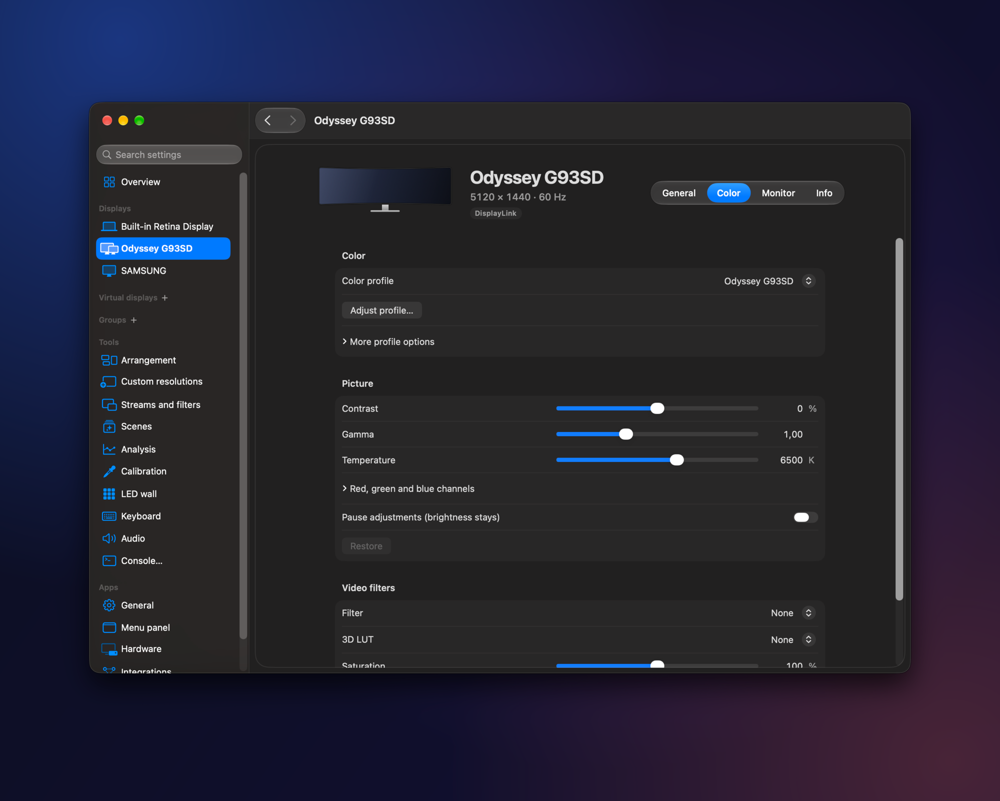<p align="center"><sub><b>Colore</b> — profili, regolazioni, filtri e LUT per ogni schermo</sub></p></td>
    <td width="50%">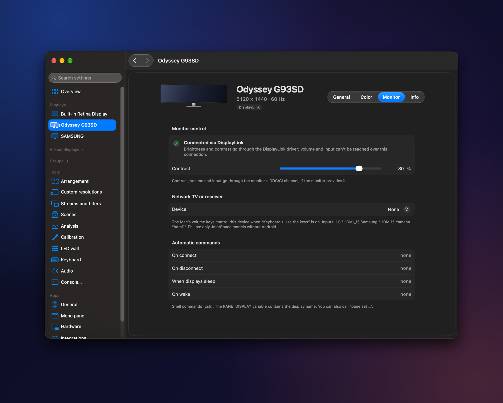<p align="center"><sub><b>Controllo del monitor</b> — DDC/CI e DisplayLink, TV in rete, comandi automatici</sub></p></td>
  </tr>
  <tr>
    <td>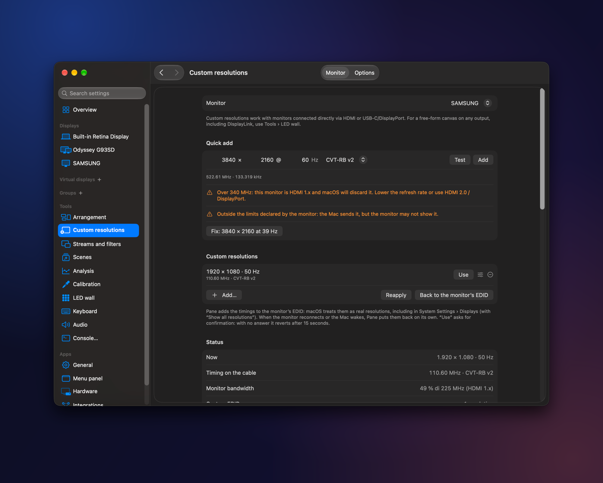<p align="center"><sub><b>Risoluzioni custom</b> — timing, banda e controllo dei limiti EDID</sub></p></td>
    <td>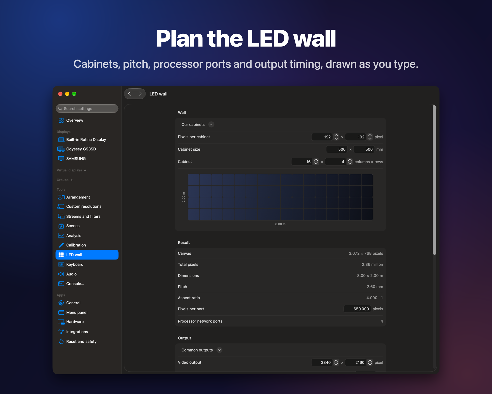<p align="center"><sub><b>LED wall</b> — tela, passo, uscite e centraline Novastar</sub></p></td>
  </tr>
  <tr>
    <td>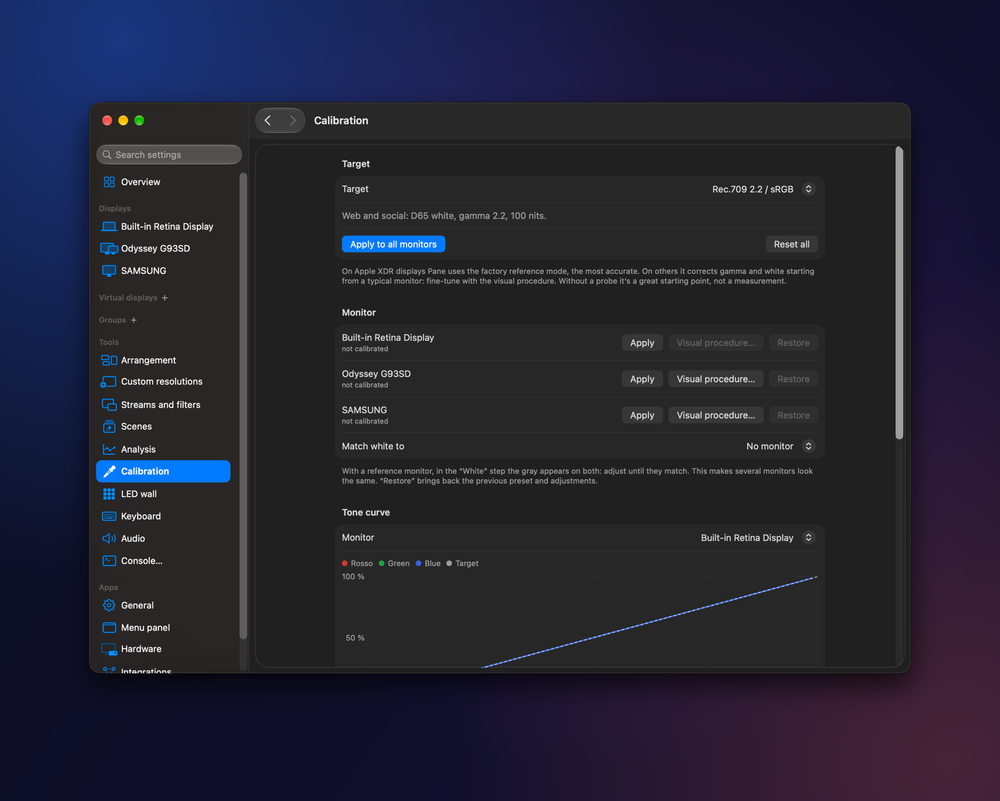<p align="center"><sub><b>Calibrazione</b> — Rec.709, sRGB, P3, DCI con procedura visiva</sub></p></td>
    <td>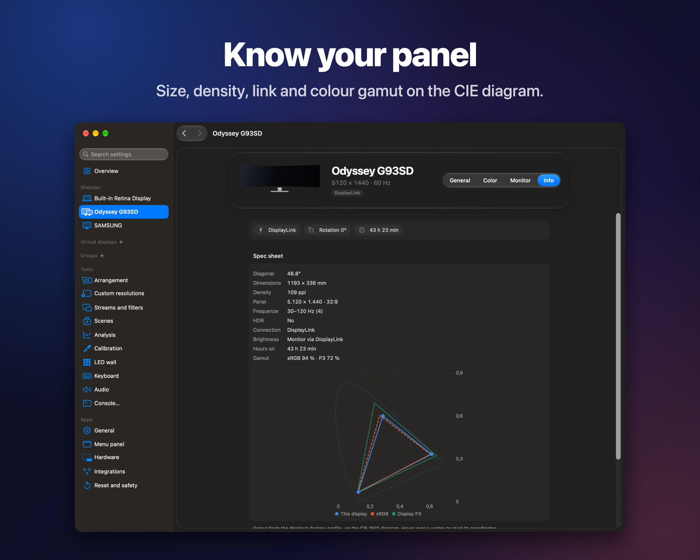<p align="center"><sub><b>Scheda tecnica</b> — dimensioni, densità, collegamento e gamut</sub></p></td>
  </tr>
  <tr>
    <td>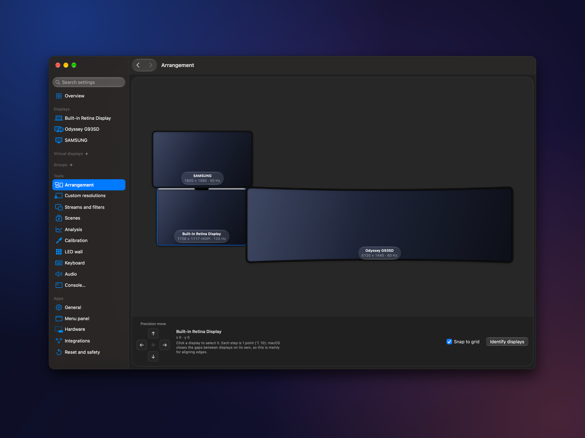<p align="center"><sub><b>Disposizione</b> — trascina gli schermi, spostali al punto</sub></p></td>
    <td>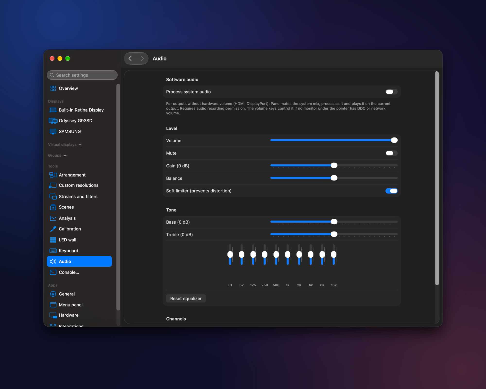<p align="center"><sub><b>Audio</b> — volume ed equalizzatore a 10 bande per ogni uscita</sub></p></td>
  </tr>
  <tr>
    <td>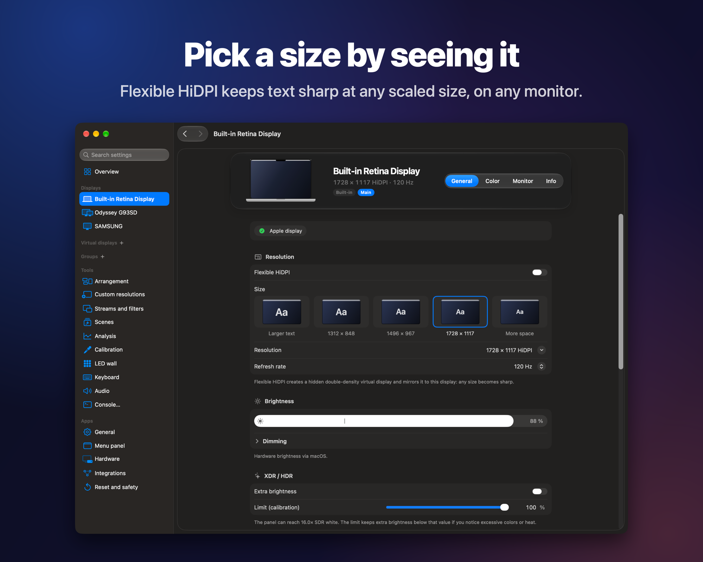<p align="center"><sub><b>Risoluzione</b> — scegli la dimensione da cinque anteprime, nitida con l'HiDPI flessibile</sub></p></td>
    <td>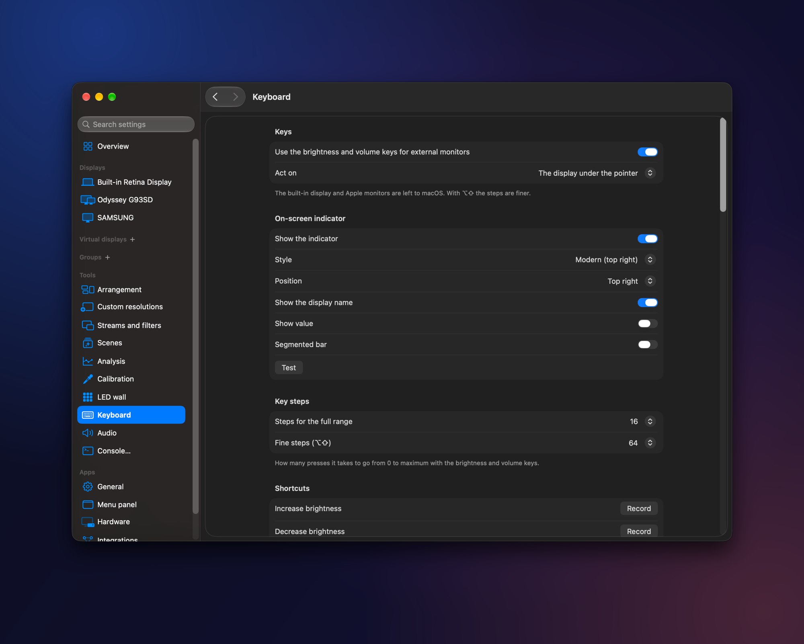<p align="center"><sub><b>Tastiera</b> — tasti luminosità, indicatore a schermo, scorciatoie</sub></p></td>
  </tr>
</table>

<p align="center">
  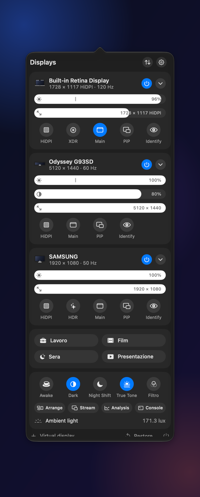<br>
  <sub><b>Pannello della barra dei menu</b> — tutti gli schermi, le scene e gli interruttori rapidi a un clic</sub>
</p>

<sub>Gli screenshot mostrano Pane in inglese; l'app è completamente tradotta in italiano.</sub>

## Installazione

**Requisiti:** un Mac con chip Apple (M1 o successivo) e macOS 26 o più recente.

1. Scarica **Pane-0.2.1.dmg** da [Releases](../../releases/latest).
2. Aprilo e trascina **Pane** nella cartella **Applicazioni**.
3. Apri Pane. La prima volta macOS dirà che non può verificare lo sviluppatore: Pane è distribuita fuori dall'App Store e non è ancora notarizzata. Premi **Fine**, apri **Impostazioni di Sistema › Privacy e sicurezza**, scorri in basso e premi **Apri comunque** accanto a Pane.
4. Pane vive nella **barra dei menu** (in alto a destra). Cliccala per il pannello; clic destro per il menu rapido; apri **Impostazioni** per tutto il resto.

Permessi che Pane può chiedere, solo per le funzioni che li usano: **Registrazione schermo** (Picture in Picture, trasmissioni), **Accessibilità** (tasti luminosità e volume), **Automazione** (aspetto chiaro/scuro).

## Automazione

Tutto quello che fa Pane si può automatizzare.

```sh
pane list                                        # schermi con modalità e frequenza
pane set display=main brightness=0.6
pane set display="Odyssey" resolution=3840x1080@2x
pane toggle display=all hdr
pane timing w=7872 h=768 hz=41 std=cvt-rb2      # timing + banda su ogni standard di collegamento
pane scene name=Sera                             # applica una scena
pane led name=Palco brightness=40                # centralina Novastar
```

- **Comando `pane`** (circa 45 comandi; si installa da Impostazioni › Integrazioni).
- Azioni per **Comandi Rapidi**: esegui un comando, imposta la luminosità, imposta la risoluzione, attiva o disattiva l'HiDPI.
- **Schema URL** — `pane://set?display=main&brightness=0.5` — limitato ai controlli degli schermi.
- **Server HTTP locale** su 127.0.0.1 con token facoltativo; le richieste dalle pagine web vengono rifiutate.
- **Widget**, una **console** e notifiche per le app HUD e notch.

## Lingue

Italiano · English · Français · Deutsch · Español · Polski · Русский · Português (Brasil) · 简体中文 · 日本語 · हिन्दी

Pane segue la lingua del Mac; puoi cambiarla in Impostazioni › Generale.

## Segnalazioni

Hai trovato un problema o hai un'idea? [Apri una segnalazione](../../issues/new/choose). Pane è giovane (versione 0.2.1): aiutano molto il modello del Mac, la versione di macOS e il monitor o l'adattatore coinvolti.

## Sicurezza

Vedi [SECURITY.md](SECURITY.md) per come Pane gestisce link, server locale e impostazioni importate, e per segnalare una vulnerabilità.

## Licenza

Pane si scarica e si usa gratuitamente. Tutti i diritti riservati — vedi [LICENSE](LICENSE). Pane include tabelle di comandi Novastar derivate da un progetto con licenza MIT; vedi [THIRD_PARTY_NOTICES.md](THIRD_PARTY_NOTICES.md).
