<p align="center">
  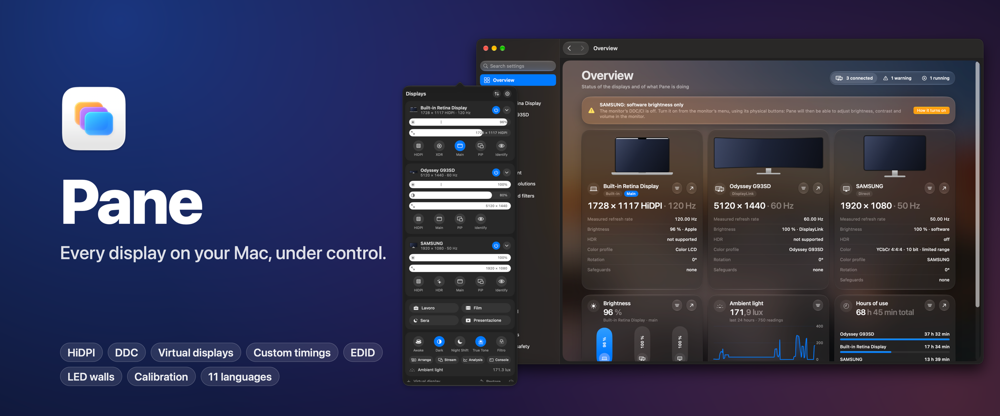
</p>

<h1 align="center">Pane</h1>

<p align="center">
  <b>The display control center for macOS.</b><br>
  HiDPI at any size, real monitor control, virtual displays, custom timings, LED walls and video calibration —<br>
  in one native app that lives in your menu bar.
</p>

<p align="center">
  
  
  
  
  
</p>

<p align="center">
  <a href="../../releases/latest"><b>⬇︎ Download</b></a> ·
  <a href="#features">Features</a> ·
  <a href="#why-pane">Why Pane</a> ·
  <a href="#screenshots">Screenshots</a> ·
  <a href="#install">Install</a> ·
  <a href="#automation">Automation</a> ·
  <a href="README.it.md">🇮🇹 Italiano</a>
</p>

---

## Overview

Pane brings every display connected to your Mac — the built-in panel, external monitors, TVs, docks, virtual screens and LED walls — into one place. It sharpens text on any monitor with **flexible HiDPI**, drives the monitor's own **brightness, contrast, volume and input** over DDC/CI, creates **virtual displays**, builds **custom resolutions down to the porch**, plans **LED walls** and talks to **Novastar** processors, and **calibrates** your screens to video standards.

It is built for people who work with screens all day: video and AV professionals, designers, developers and anyone with more than one display. Native SwiftUI and Liquid Glass, no Electron: a 6 MB download that sits at 0 % CPU when idle.

<p align="center">
  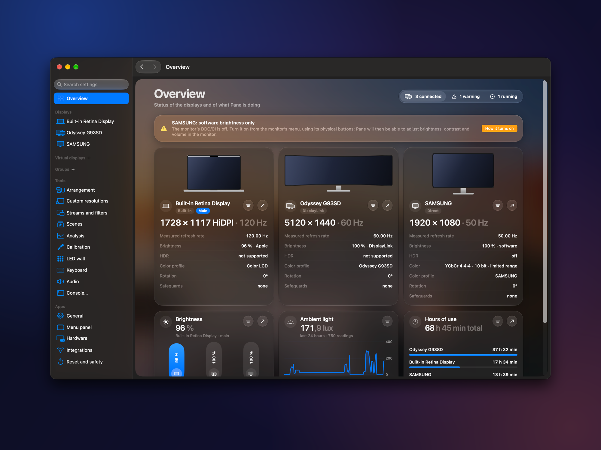
</p>

## Why Pane

Pane covers what you expect from a display utility — flexible HiDPI, virtual displays, DDC/CI, picture in picture, EDID tools, XDR brightness — and adds tools you won't find in other display apps:

| | **Pane** | BetterDisplay | SwitchResX |
| --- | :---: | :---: | :---: |
| **Novastar LED processor control** (VX series incl. VX Pro, H series): brightness, input, presets, freeze, black, test patterns | ✅ | — | — |
| **LED wall planner**: cabinets → canvas, pitch, size, processor ports, output timing, strip-folded output | ✅ | — | — |
| **Timing planner with link bandwidth** for HDMI 1.4 / 2.0 / 2.1 and DisplayPort 1.2 / 1.4 / DSC / 2.1, *before* you apply | ✅ | — | — |
| **Checks against the monitor's EDID limits** with a one-click fix (lines, pixel clock, TMDS) | ✅ | — | — |
| **Video calibration** to Rec.709, sRGB, Display P3 and DCI-P3, with a visual wizard and white matching between monitors | ✅ | — | — |
| **Scenes with triggers**: time of day, ambient light above/below a level, a display connecting | ✅ | — | — |
| **Undo history** of the last 10 changes (⌃⌥⌘Z) and a backup before every reset | ✅ | — | — |
| **Price** | Free | Free + paid Pro | Paid |

<sub>Based on each app's public feature list (betterdisplay.pro, madrau.com) as of November 2026; “—” means the feature is not listed there. BetterDisplay and SwitchResX are trademarks of their respective owners. Pane is an independent app and is not affiliated with them.</sub>

### Built to be safe

Changing displays can leave you with a black screen. Pane is designed so that never sticks:

- **Every risky change asks “Keep?”** on every screen and reverts by itself if you don't answer (resolution, refresh, rotation, EDID, colour mode).
- **⌃⌥⌘Z undoes** the last command, up to 10 steps.
- **Reset to macOS defaults** always takes a backup first, and the reset itself can be undone.
- **Configuration protection** keeps resolution, refresh rate, rotation, colour profile, main display and mirroring the way you set them.
- Links and the local web server can only run display controls: shell commands, file writes and settings stay with you. Importing someone else's settings file asks before bringing in any shell command.

## Features

### Resolution and HiDPI
- **Flexible HiDPI on any monitor**: crisp text at any scaled size, even on monitors macOS only offers at native resolution.
- Resolution slider, five favourite resolutions, refresh rates, ProMotion/VRR ranges, default · native · half-native in one click.
- Notch-area toggle on MacBooks, rotation, main display, mirroring, Apple reference presets on XDR displays.
- Measured refresh rate (not just the nominal one) and frame-pacing tests.

### Brightness and image
- One brightness slider per display: **hardware first** (Apple, DDC/CI, DisplayLink docks), then **software dimming down to black**.
- **XDR / HDR extra brightness** on supported displays.
- Contrast, gamma, colour temperature, RGB gain, per-channel gamma, quantization — live, per display.
- Colour profiles with five favourites, **profile retouching** (contrast, gamma, warm/cool, magenta/green), **3D LUTs** (.cube) and video filters.

### Monitor control
- **DDC/CI**: brightness, contrast, volume, mute, input (with your own names), power, plus any VCP code as a custom control, and timing options for difficult monitors.
- **DisplayLink docks**: hardware brightness and contrast where most apps fall back to software.
- **Network TVs and receivers** (LG, Samsung, Philips, Yamaha) and **HDMI-CEC** — *experimental*.
- Shell commands when a display connects, disconnects, sleeps or wakes.

### Virtual displays
- Virtual screens up to 16K, HiDPI, custom refresh rates and diagonal — for headless Macs, screen sharing and recording.
- Associate one with a physical display: connect it automatically when the display is off, stream it full screen, or keep the display mirroring it.

### Picture in Picture and streaming
- **Picture in Picture** of any display or of chosen windows, with zoom, crop, rotation, opacity, click-through and filters.
- **Stream** a display full screen onto another one — including **strip folding** for LED walls fed by a standard video output.

### Custom resolutions and timings
- **Timing calculator**: CVT, CVT-RB, CVT-RB v2, GTF and CTA-861, editable down to porches, sync polarity and pixel clock; video rates (59.94, 29.97, 23.976).
- **Bandwidth per link standard** before you apply, and **warnings against the monitor's own EDID limits** with an automatic fix.
- Copy and paste **modelines**, build a **DisplayID EDID**, apply custom timings to directly connected HDMI/DisplayPort monitors, or install a system display override.
- EDID viewer with export (bin, hex, base64, C array) and *experimental* EDID write.

### LED walls
- **Wall planner**: pixels per cabinet, cabinet size and count → canvas, total pixels, dimensions, pixel pitch, aspect ratio and the processor ports you need.
- **Output planning**: common outputs, refresh, number of strips, the canvas timing (CVT-RB v2) and a cabinet test grid.
- **Novastar control** for the VX series (VX4S, VX6s, VX16S, VX600, VX1000, VX Pro, J6, NovaPro, MCTRL) and the **H series**: brightness, input, presets, freeze, black, test patterns. Built-in simulators let you try everything without a processor.

### Calibration
- Targets: **Rec.709 · BT.1886** (gamma 2.4), **sRGB / web** (gamma 2.2), **Display P3** and **DCI-P3 cinema** (gamma 2.6, DCI white).
- On Apple XDR displays Pane uses the factory reference mode; elsewhere it corrects gamma and white and you refine it with a **visual wizard** (black, gamma, white).
- **White matching**: make several monitors look the same.
- Live tone curve and CIE white chart, read from the colour tables macOS is actually using.

### Layout and groups
- **Arrangement editor** with snapping and point-precise moves.
- **Groups**: sync brightness and image, normalize brightness in nits, match UI scale, protect the layout with rules (A left of B, above C…).

### Scenes and automation
- **Scenes** apply brightness, resolution, refresh rate, HDR and colour profile per display, plus Night Shift, True Tone and keep-awake, in one click from the menu bar or a shortcut.
- **Triggers**: at a time of day, when a display connects, when ambient light goes above or below a level.

### Audio
- **Software audio** for outputs that have no volume control (HDMI, DisplayPort, many docks): volume, mute, gain, balance, soft limiter, 10-band equalizer, bass and treble, mono, channel swap, polarity.

### Keyboard
- Brightness and volume keys for external monitors (the one under the pointer, the main one or all), modern or classic on-screen indicator.
- **64 actions** you can bind to global shortcuts: brightness, resolution, HiDPI, XDR, PiP, scenes, favourites, undo and more.

### Insight
- **Overview dashboard**: every display at a glance, warnings with a direct link to the setting that fixes them.
- **Analysis**: brightness over 24 hours, ambient light, hours of use per display.
- **Spec sheet** for each display: size, density, panel, link, colour gamut (sRGB and P3 coverage).
- Screen tests: colours, uniformity, banding, motion, grid, LED cabinets.

### Everyday comfort
- **Menu bar panel** with sliders, quick toggles and scenes — compact, or as a side panel like Control Center — and modules you can reorder.
- **Search every setting**: results take you to the exact row and highlight it.
- Drag to reorder the sidebar, widgets for the desktop and Notification Center.

## Screenshots

<table>
  <tr>
    <td width="50%">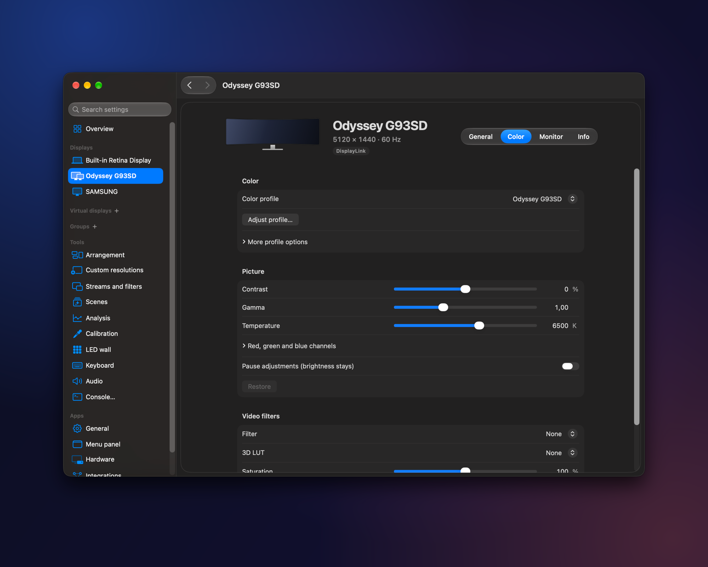<p align="center"><sub><b>Colour</b> — profiles, image adjustments, filters and LUTs per display</sub></p></td>
    <td width="50%">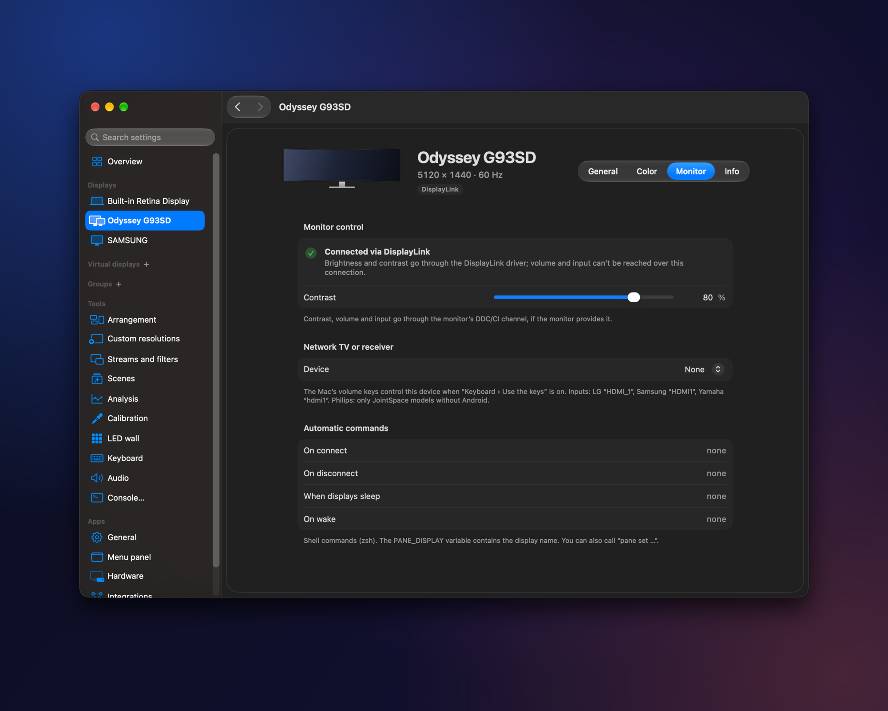<p align="center"><sub><b>Monitor control</b> — DDC/CI and DisplayLink, network TVs, automatic commands</sub></p></td>
  </tr>
  <tr>
    <td>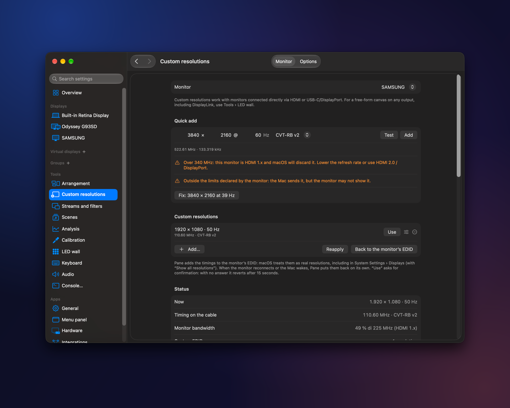<p align="center"><sub><b>Custom resolutions</b> — timings, bandwidth and EDID limit checks</sub></p></td>
    <td>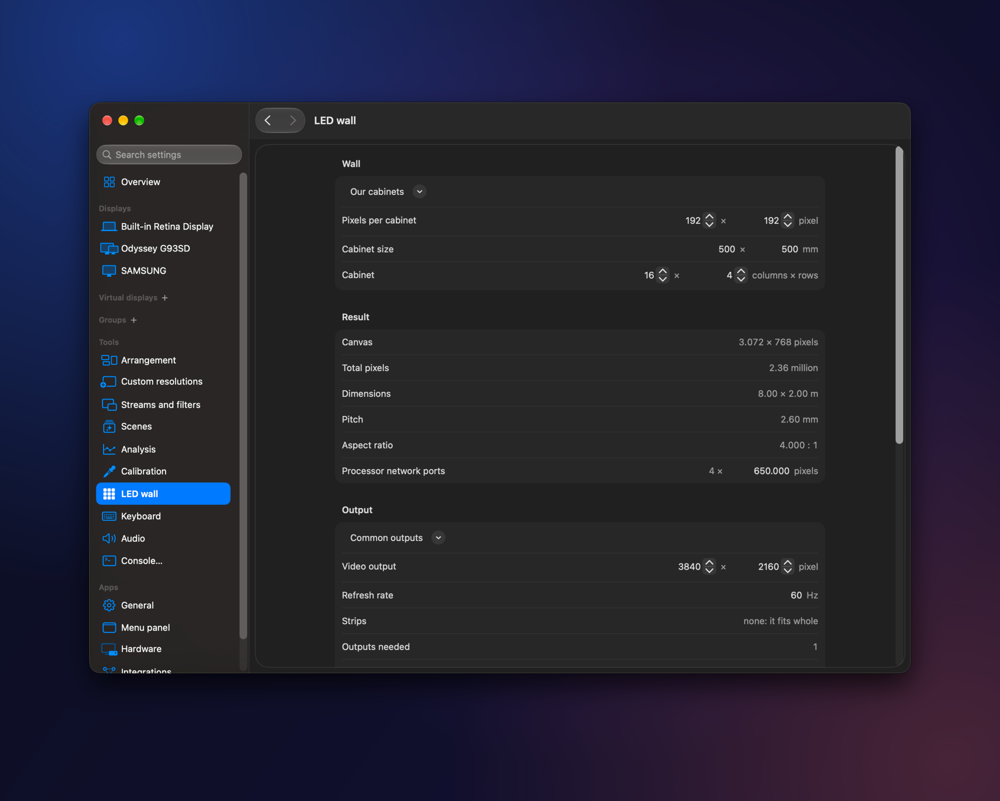<p align="center"><sub><b>LED wall</b> — canvas, pitch, outputs and Novastar processors</sub></p></td>
  </tr>
  <tr>
    <td>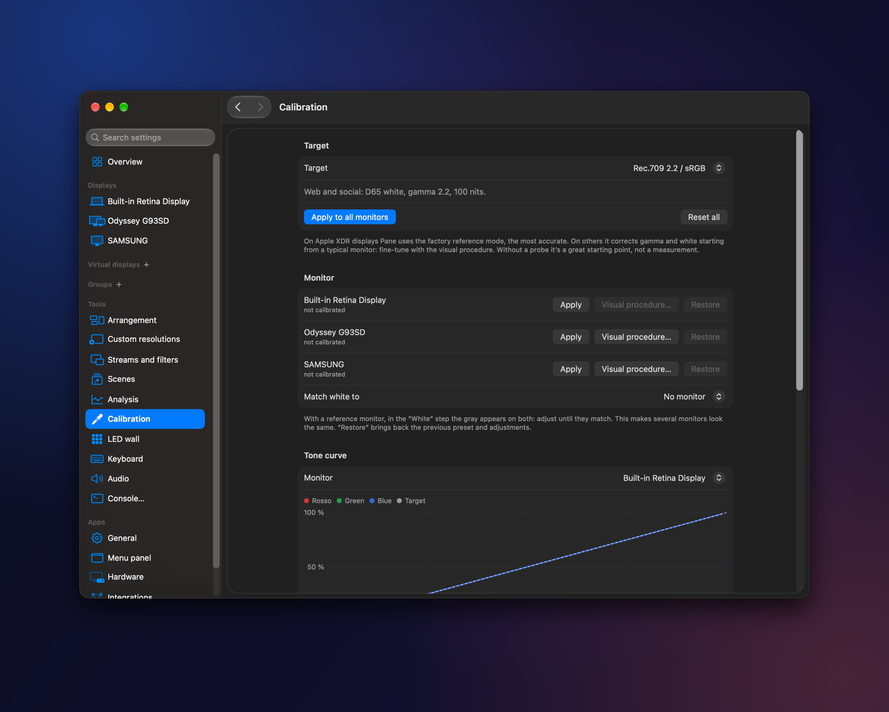<p align="center"><sub><b>Calibration</b> — Rec.709, sRGB, P3, DCI with a visual wizard</sub></p></td>
    <td>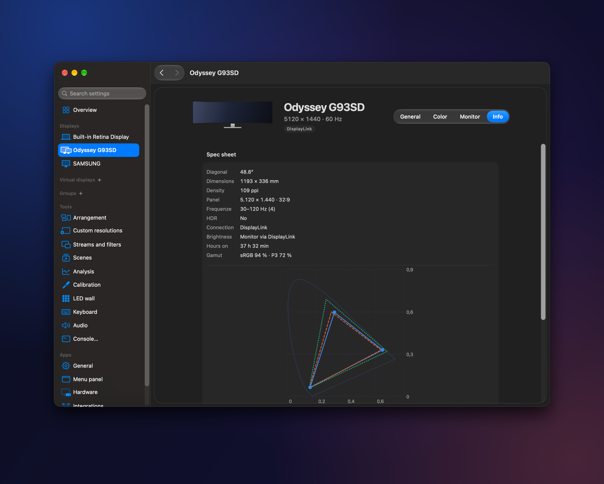<p align="center"><sub><b>Spec sheet</b> — size, density, link and colour gamut</sub></p></td>
  </tr>
  <tr>
    <td>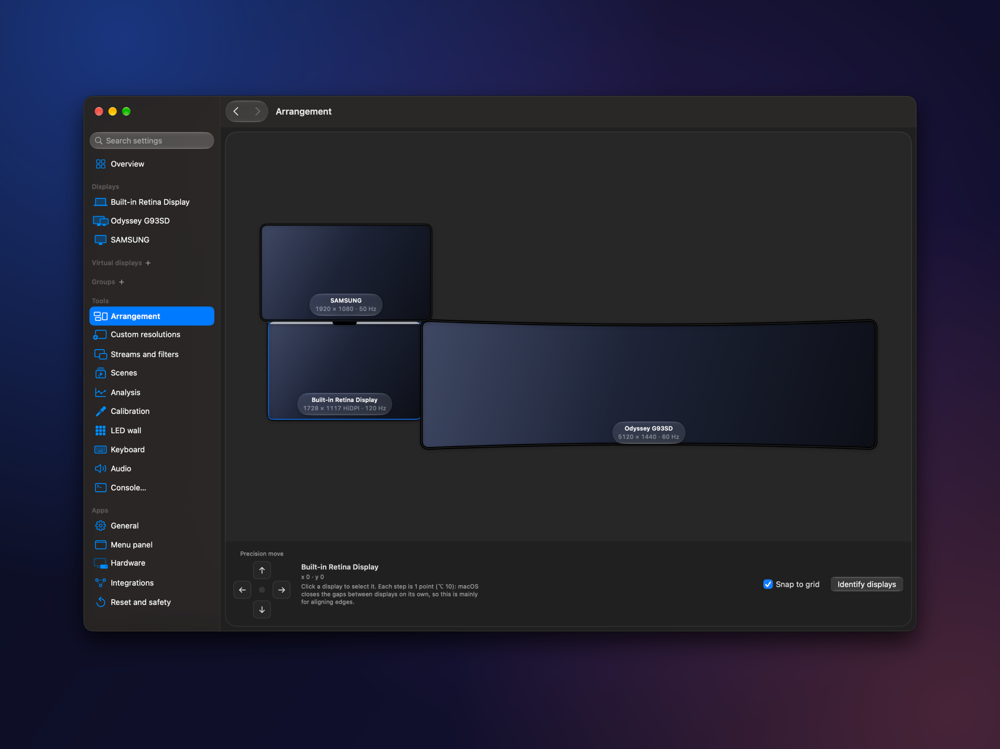<p align="center"><sub><b>Arrangement</b> — drag displays, move them point by point</sub></p></td>
    <td>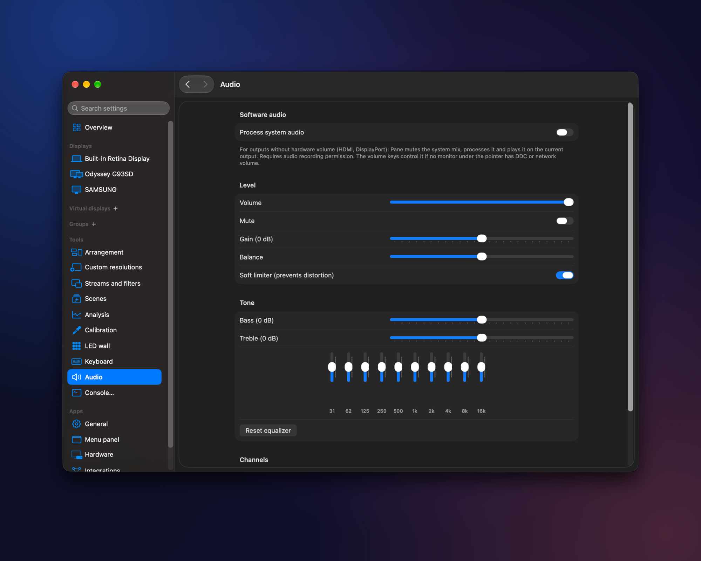<p align="center"><sub><b>Audio</b> — volume and a 10-band EQ for any output</sub></p></td>
  </tr>
  <tr>
    <td>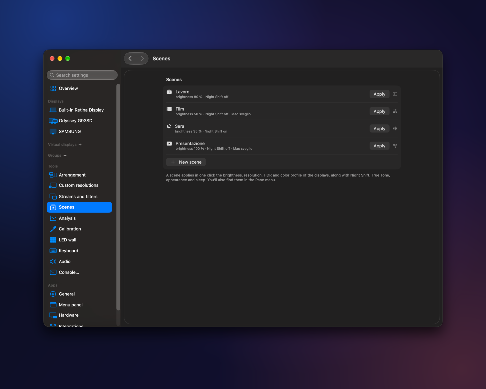<p align="center"><sub><b>Scenes</b> — one click, or automatic by time, light or connection</sub></p></td>
    <td>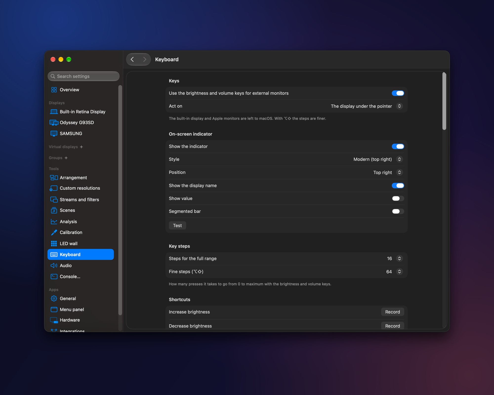<p align="center"><sub><b>Keyboard</b> — brightness keys, on-screen indicator, shortcuts</sub></p></td>
  </tr>
</table>

<p align="center">
  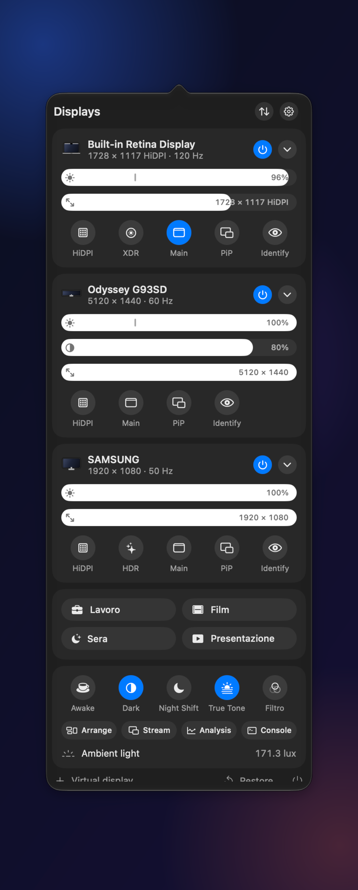<br>
  <sub><b>Menu bar panel</b> — every display, scenes and quick toggles one click away</sub>
</p>

## Install

**Requirements:** a Mac with Apple silicon (M1 or later) and macOS 26 or later.

1. Download **Pane-0.1.dmg** from [Releases](../../releases/latest).
2. Open it and drag **Pane** into **Applications**.
3. Open Pane. The first time macOS says it can't verify the developer: Pane is distributed outside the App Store and is not notarized yet. Press **Done**, open **System Settings › Privacy & Security**, scroll down and press **Open Anyway** next to Pane.
4. Pane lives in the **menu bar** (top right). Click it for the panel; right-click for the quick menu; open **Settings** for everything else.

Permissions Pane may ask for, only for the features that need them: **Screen Recording** (picture in picture, streaming), **Accessibility** (brightness and volume keys), **Automation** (light/dark appearance).

## Automation

Everything Pane does can be scripted.

```sh
pane list                                        # displays with mode and refresh
pane set display=main brightness=0.6
pane set display="Odyssey" resolution=3840x1080@2x
pane toggle display=all hdr
pane timing w=7872 h=768 hz=41 std=cvt-rb2      # timing + bandwidth on every link standard
pane scene name=Evening                          # apply a scene
pane led name=Stage brightness=40                # Novastar processor
```

- **`pane` command** (about 45 commands; install it from Settings › Integrations).
- **Shortcuts** actions: run a command, set brightness, set resolution, toggle HiDPI.
- **URL scheme** — `pane://set?display=main&brightness=0.5` — limited to display controls.
- **Local HTTP server** on 127.0.0.1 with an optional token; requests from web pages are refused.
- **Widgets**, a **console** and notifications for HUD and notch apps.

## Languages

English · Italiano · Français · Deutsch · Español · Polski · Русский · Português (Brasil) · 简体中文 · 日本語 · हिन्दी

Pane follows your Mac's language; you can change it in Settings › General.

## Feedback

Found a bug or have an idea? [Open an issue](../../issues/new/choose). Pane is young (version 0.1): reports with your Mac model, macOS version and the monitor or adapter involved help most.

## Security

See [SECURITY.md](SECURITY.md) for how Pane handles links, the local server and imported settings, and how to report a vulnerability.

## License

Pane is free to download and use. All rights reserved — see [LICENSE](LICENSE). Pane includes Novastar command tables derived from an MIT-licensed project; see [THIRD_PARTY_NOTICES.md](THIRD_PARTY_NOTICES.md).
